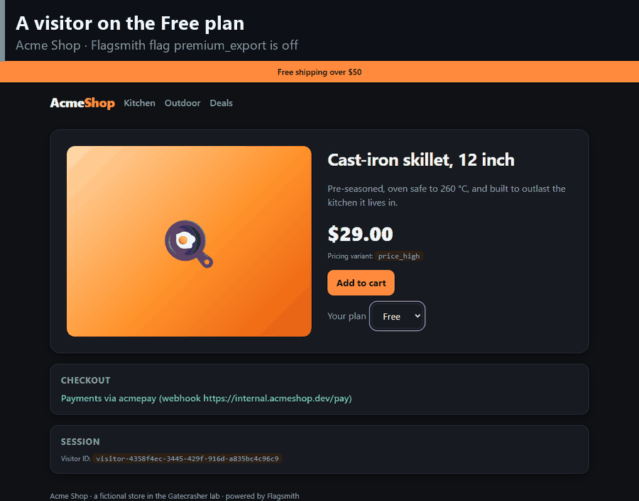
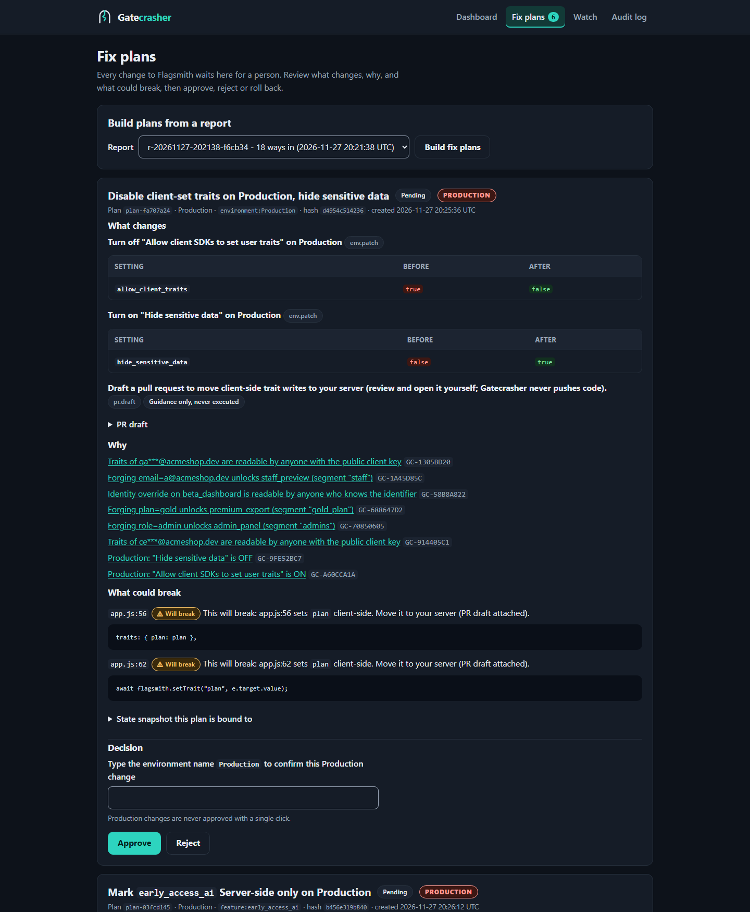
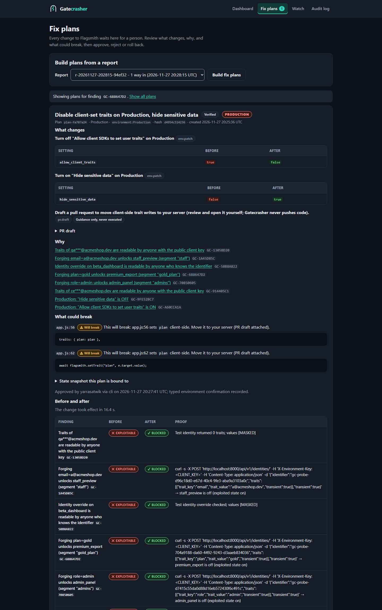
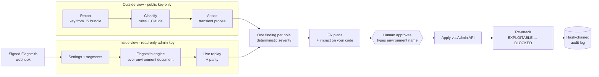

<div align="center">

# Gatecrasher

### What if your users changed `plan=silver` to `plan=gold`?

**The AI red-team agent for Flagsmith.** Gatecrasher attacks your own Flagsmith setup the way an outsider would, maps every flag value a user can reach with Flagsmith's own evaluation engine, and — after a human approves — fixes each hole and attacks again to prove it is closed.

[](https://github.com/yarrasatwik/gatecrasher/actions/workflows/ci.yml)
[](LICENSE)


**Toggle Wars — The Flagsmith Experimentation Hackathon (WeMakeDevs × Flagsmith)**
Track 02 · AI Agents and Feature Flags  ·  Track 03 · Build on Open Source Flagsmith

<!-- VIDEO_URL -->

*Your flags are a security boundary. Gatecrasher proves whether it holds.*



</div>

## The problem

Feature flags quietly became access control: paid plans, admin tools, betas, pricing experiments. Flagsmith's own documentation describes exactly where that boundary needs care:

| Flagsmith documents that… | …so an outsider can |
|---|---|
| Client SDKs can set user traits without credentials, and **"Allow client SDKs to set user traits" is on by default** ([Security](https://docs.flagsmith.com/system-administration/security), [Segments](https://docs.flagsmith.com/managing-segments)) — their example is changing `plan=silver` to `plan=gold` | unlock paid or admin features with one forged trait |
| Client-side environment keys are **public by design** ([Integration overview](https://docs.flagsmith.com/clients/overview)) | read the key from your JS bundle and call Flagsmith as your app |
| Flags reach the browser unless marked **Server-side only** ([Managing features](https://docs.flagsmith.com/basic-features/managing-features)) | read secrets, internal URLs and unreleased product names |
| Identity responses include traits unless **"Hide sensitive data"** is on ([Security](https://docs.flagsmith.com/system-administration/security)) | read another user's phone number or lifetime value |
| Rollouts and variants hash an identifier **the client chooses** | re-roll into a 10% early-access rollout or the cheaper arm of a pricing experiment — and bias the experiment |

Gatecrasher is the first tool that tests this from **your users' side**. Approval and policy tools in the Flagsmith ecosystem control *who may change a flag*; Gatecrasher checks whether *users can get around* the flags you already have.

## See it work

A real run against the self-hosted lab (full output in [`examples/acme-shop`](examples/acme-shop)):

```text
$ gatecrasher audit
recon     client key found at app.js:4 key-shaped string near flagsmith; 12 flags visible
classify  classifying flag names and values · AI on (Claude via Claude Code)
attack    testing 40 trait hypotheses and configured test identities
map       engine found 6 reachable flag states
verify    cross-checking every engine result against the live Flags API (transient identities)
parity    engine vs live parity over 200 random identities

  8 ways in · 17 findings    4 critical · 5 high · 6 medium · 2 low
  engine vs live parity: 200/200 agree

   CRIT  Browsers choose the identifier that unlocks internal_tools (way in)
      CRIT  Choosing identifier a@acmeshop.dev unlocks internal_tools — this survives turning off client traits. ✓ reproduced live
   CRIT  Production lets clients set traits (way in)
      CRIT  Forging role=admin unlocks admin_panel (segment "admins")              ✓ reproduced live
      CRIT  Forging email=a@acmeshop.dev unlocks staff_preview (segment "staff")   ✓ reproduced live
      HIGH  Forging plan=gold unlocks premium_export (segment "gold_plan")         ✓ reproduced live
      MED   Production: "Allow client SDKs to set user traits" is ON
   CRIT  payment_config is served to browsers and contains a live secret (way in)
   ...

# approve each plan in the web UI (gatecrasher serve) or in your own terminal
  4 plans applied through the Flagsmith CLI · 14 findings EXPLOITABLE → BLOCKED

$ gatecrasher audit
  3 ways in · 3 findings    (each one is a browser choosing its own identifier: a server change, drafted for you)
```



| Every finding, explained and reproducible | Proof after the fix |
|---|---|
|  |  |

## What it does

- **Thinks like an attacker, with Claude.** Claude reads the redacted flag inventory, suggests secrets and roadmap leaks the rules may miss, proposes the trait values most likely to unlock something, explains each finding in plain English and drafts the PR that fixes it. It never decides what is real or touches Flagsmith: its own suggestions are listed under "Claude suggests reviewing" and count only after a deterministic rule or a person confirms them.
- **Recon like an outsider.** Fetches your site, follows its scripts, extracts the Flagsmith client key and API host, and lists every flag a visitor receives.
- **Attacks safely.** Forged traits (each confirmed twice, minimal trait sets only), identifier re-rolls, test-identity lookups, config leaks and experiment rigging — all with transient identities that Flagsmith never stores.
- **Maps from the inside with Flagsmith's own engine.** Loads the environment document into the official SDK's evaluation engine, solves every segment rule (REGEX, PERCENTAGE_SPLIT, nested ALL/ANY/NONE, semver, modulo…) for the smallest forged input, and replays each answer against the live API.
- **Fixes with a human in the loop.** Each plan shows what changes, why, and which lines of *your* code it will affect, with a PR draft. A person approves in the web UI or a real terminal by typing the environment name; Gatecrasher applies it through the Flagsmith CLI, waits until the live API stops reproducing the hole, re-attacks, and can roll back at any time.
- **Counts honestly.** One fixable root cause is one way in, however many findings it causes ("8 ways in · 17 findings"). A hole that a fix only hides from client SDKs is reported as `HIDDEN` and stays open; found − blocked = remaining is checked on every report.
- **Watches continuously.** A signed Flagsmith webhook re-maps every flag or segment change and alerts within seconds.
- **Fits your workflow.** CLI, web UI, GitHub Action with code-scanning alerts, Slack alerts, and a read-only MCP server so Claude Code or Cursor can ask *"is my Flagsmith setup safe?"*

## Architecture



| Stage | View | Writes to Flagsmith? |
|---|---|---|
| **Recon → Attack** | Outside, public key only | Never |
| **Map** (engine + live replay + parity) | Inside, read-only admin key | Never |
| **Fix → Re-attack → Rollback** | Inside | **Only after a human approves** |
| **Watch** | Inside, signed webhook | Only after a human approves |

## How Flagsmith is used

| Flagsmith capability | What Gatecrasher does with it |
|---|---|
| Client-side environment key | Extracts it from the JS bundle, exactly like an outsider ([`recon`](internal/recon)) |
| Flags API | Public inventory, leak detection, Server-side only verification ([`sdk.go`](internal/flagsmith/sdk.go)) |
| Identities API with **transient identities** | Every probe, live replay and parity check — nothing is stored ([`attacks`](internal/attacks)) |
| Traits + "Allow client SDKs to set user traits" | Forgery tests, settings audit, the primary fix ([`mapper`](internal/mapper), [`fixes`](internal/fixes)) |
| "Hide sensitive data" | Identity trait and override exposure, and its fix ([`identities.go`](internal/app/identities.go)) |
| Server-side only features | Finds sensitive values that reach browsers; marks them server-only ([`planner.go`](internal/fixes/planner.go)) |
| Segments, rules, overrides, priorities | Constraint solver for every operator ([`mapper`](internal/mapper)) |
| Identity overrides | Mapped from the environment document ([`identities.go`](internal/app/identities.go)) |
| Remote config values | Secret, internal URL, PII, pricing and roadmap classification ([`secrets`](internal/secrets), [`ai`](internal/ai)) |
| Environment document + **official SDK evaluation engine** | Offline evaluation with `flagsmith-go-client/v5` v5.7.0's engine; 1000/1000 parity with the live API ([`engine.go`](internal/flagsmith/engine.go), [`parity`](internal/parity)) |
| **Flagsmith Experimentation** | Detects running experiments, flags rigging, protects them during fixes ([`audit.go`](internal/app/audit.go)) |
| Organisation webhooks (HMAC-signed) | Watch mode, signature verified exactly as Flagsmith signs ([`watch`](internal/watch)) |
| **Flagsmith CLI v2** | Applies approved changes (`flagsmith environment update`, `flagsmith api`); every lab change in CI goes through it ([`cli.go`](internal/fixes/cli.go)) |
| v2 feature versioning | The lab keeps Development on v2 and Production on v1; audit, fix and rollback are proven on both ([`seed_data.yaml`](lab/seed_data.yaml)) |
| Admin API | Inside view and rollback; fallback when the CLI is not installed ([`admin.go`](internal/flagsmith/admin.go)) |
| Self-hosted official Docker images | One-command lab, also run end to end in CI ([`lab/compose.yaml`](lab/compose.yaml)) |

Every endpoint was verified against a running Flagsmith before code relied on it — see [`docs/api-verification.md`](docs/api-verification.md) and the 29 recorded responses in [`tests/fixtures`](tests/fixtures).

## Who decides what

| Action | Decided by |
|---|---|
| Extract the key, fetch flags, classify values | Agent, on its own (read-only, like any visitor) |
| Generate attack ideas | AI (Claude), on its own |
| Run probes | Agent, on its own — transient identities, scope-locked |
| Whether a finding is real | **Deterministic code** — only a live probe or the engine can confirm it |
| Severity | Deterministic rules; the AI only explains in plain English |
| Any change to Flagsmith | **A human**, in the web UI or a real terminal, typing the environment name for Production |
| Approving from a script, CI or a coding agent | **Refused.** A coding agent cannot approve: protected environments require a real terminal or the web UI, and Gatecrasher refuses inside agent and CI sessions. |
| Changing a flag under a running experiment | **A human**, typing `contaminate-experiment` |
| Moving `setTrait` calls or secrets to your server | **A human** reviews the PR draft Gatecrasher writes |

## Built to be trusted

| Guarantee | How |
|---|---|
| Scope lock | Every request and redirect is checked against your allow-list; there is no override ([`scope`](internal/scope)) |
| No stored probe data | Transient identities only, prefixed `gc-probe-`; identity lookups only for configured test identities |
| The AI never acts | No tools, no credentials, redacted input, schema-checked output; a guard blocks any prompt containing key material ([`ai`](internal/ai)) |
| Approvals bound to state | Plan hash + live snapshot; stale plans are refused; approvals expire after 30 minutes ([`approvals.go`](internal/fixes/approvals.go)) |
| Keys never leave | Central redaction on every output — terminal, reports, AI prompts, MCP, audit log ([`redact`](internal/redact)) |
| Tamper-evident history | Hash-chained audit log, verified in the CLI and web UI ([`audit`](internal/audit)) |
| One-click undo | Rollback restores the exact before-state and is safe to repeat ([`rollback.go`](internal/fixes/rollback.go)) |
| Clean commits | Pre-commit hook blocks `.env*`, state files and key patterns ([`.githooks/pre-commit`](.githooks/pre-commit)) |

## Quick start

Needs Docker and Go 1.25+.

```bash
git clone https://github.com/yarrasatwik/gatecrasher && cd gatecrasher
make install      # builds bin/gatecrasher and enables the secret-blocking hook
make lab-up       # official self-hosted Flagsmith (Postgres, API, task processor)
make lab-seed     # the Acme Shop project with 13 planted misconfigurations; writes .env
make shop &       # the Acme Shop storefront on http://localhost:3030
make audit        # → reports/latest.{html,md,json,sarif}
```

Then fix and prove it:

```bash
bin/gatecrasher serve --watch    # web UI on http://127.0.0.1:8787: review and approve plans, live alerts
bin/gatecrasher fix-all          # or, in your own terminal: type the environment name and the plan-hash suffix
make lab-reset                   # restore the lab
```

### For judges in 60 seconds

```bash
make verify                 # no Docker, no keys: vet + 600+ test cases + build
make lab-up lab-seed        # then, the full run (~3 minutes):
make shop &
make audit
```

Or open the recorded run: [`examples/acme-shop`](examples/acme-shop) — the HTML report, SARIF, the approval session and the before/after proof.

## Use it on your own Flagsmith

Works with Flagsmith Cloud and self-hosted.

1. Copy [`gatecrasher.example.yaml`](gatecrasher.example.yaml) to `gatecrasher.yaml`: your site, its hosts, your Flagsmith API host, project and environments.
2. Add keys to `.env` ([`.env.example`](.env.example)):
   - **Outside view:** none — Gatecrasher finds your public client key itself.
   - **Inside view:** `GATECRASHER_ORG_API_KEY` — a dedicated organisation key; read-only is enough for audits and CI.
   - **AI:** Claude classifies values, proposes attack ideas, explains findings and drafts PRs. Use `ANTHROPIC_API_KEY`, or set `ai: claude-code` to run through a signed-in Claude Code CLI (no API key; every tool disabled).
3. `gatecrasher audit` → `plan` → approve in `gatecrasher serve` (or `approve` in your own terminal) → `apply` → `verify`. `--confirm` works only for unprotected environments such as Development.

If no client key is found (mobile apps, server-rendered pages), set `GATECRASHER_CLIENT_KEYS=Production=<key>`.

### GitHub Action

```yaml
permissions:
  contents: read
  security-events: write
jobs:
  flagsmith-security:
    runs-on: ubuntu-latest
    steps:
      - uses: actions/checkout@v7
      - uses: yarrasatwik/gatecrasher@main
        with:
          api-url: https://edge.api.flagsmith.com/api/v1/
          org-api-key: ${{ secrets.FLAGSMITH_ORG_API_KEY }}
          project: My Project
          environment: Production
          fail-on: high
```

Findings appear in the repository's **Security → Code scanning** tab, with a job summary and a configurable failure threshold.

### MCP server for coding agents

```bash
claude mcp add gatecrasher -- gatecrasher mcp -config /path/to/gatecrasher.yaml
```

Tools: `gatecrasher_audit`, `gatecrasher_findings`, `gatecrasher_explain` — all read-only. Changes always go through the approval flow.

## Measured results

From the recorded run in [`examples/acme-shop`](examples/acme-shop) against self-hosted Flagsmith 2.295.2 (Windows 11, Docker Desktop). CI repeats the scenarios against real Flagsmith on every pull request.

| Measure | Result |
|---|---|
| Planted misconfigurations found | **13 / 13**, zero false positives on control flags |
| First audit | **8 ways in · 17 findings** (4 critical, 5 high, 6 medium, 2 low) · 669 API requests |
| After approved fixes | **3 ways in · 3 findings**: 14 of 17 findings EXPLOITABLE → BLOCKED (17 − 14 = 3) |
| What is left | Three holes where the browser chooses its own identifier, including one that survives turning off client traits; each needs a server change, and Gatecrasher drafts it |
| Engine vs live API parity | **1000 / 1000** identities agree · 200 / 200 in every audit |
| Changes applied through the official Flagsmith CLI | **5 / 5**, all re-verified |
| Fix live on the API | **1.1 s** for Server-side only · **5.0 s** for the client-traits setting (Gatecrasher waits for every API worker, then re-attacks) |
| Watch alert after a dashboard change | **7.9 s** from the change to the alert in the web UI |
| Full audit | **14 s** with built-in heuristics · **152 s** with Claude explaining every finding |
| Claude vs deterministic classification | **92 %** agreement; Claude-only suggestions are listed for review, never counted |
| Integration suite | 9 end-to-end scenarios against real Flagsmith on every PR (v1 and v2 environments) |

## Stress-tested

Each of these is proven by a test that failed before the fix:

- **Agents cannot approve.** Piped input, `--confirm` on Production and agent or CI sessions are refused; the web UI enforces a 3-second review.
- **No false CRITICALs** on public-by-design keys (Stripe publishable, Firebase web, Mapbox public, Sentry DSNs), commit hashes or UUIDs.
- **Credentials in URLs are caught** (`postgres://user:password@…` and any other scheme) as CRITICAL.
- **Key headers never follow redirects.**
- **Webhook replays are ignored**, and stale or future events are refused.
- **Identifier-rule depth:** a segment on the identifier still unlocks `internal_tools` after client traits are turned off, and Gatecrasher says so.
- **Honest counts:** one root cause per way in, `HIDDEN` for holes that are only hidden, and found − blocked = remaining on every report.

Decisions and what we learned about Flagsmith along the way: [`docs/decisions.md`](docs/decisions.md).

## Tech stack

Go (single static binary) · official Flagsmith Go SDK evaluation engine · Flagsmith CLI v2 · Flagsmith Admin, Flags and Identities APIs · Flagsmith Experimentation · Anthropic Claude (API or Claude Code) · `net/http` + `html/template` + HTMX web UI · SARIF 2.1.0 · Model Context Protocol · Docker Compose with official Flagsmith images · GitHub Actions.

## Repository map

```
cmd/gatecrasher/     CLI: lab, audit, plan, approve, apply, verify, rollback, fix-all, serve, watch, ci, mcp
internal/app/        orchestrator: one finding per hole, live replay, fix loop, watch
internal/attacks/    outside probes (transient identities)
internal/mapper/     settings audit, rule solver, engine reachability
internal/flagsmith/  SDK API, Admin API, environment document, evaluation engine
internal/fixes/      plans, approvals, apply, rollback, impact analysis
internal/report/     HTML, Markdown, JSON, SARIF
internal/server/     web UI      internal/watch/  signed webhooks      internal/mcp/  MCP server
lab/                 self-hosted Flagsmith, Acme Shop seed and storefront
tests/integration/   end-to-end suite against real Flagsmith
examples/acme-shop/  a recorded run: reports, approval session, before/after
```

## Team

Built by [**yarrasatwik**](https://github.com/yarrasatwik) for Toggle Wars, 26–29 November 2026.

## License

[MIT](LICENSE)
